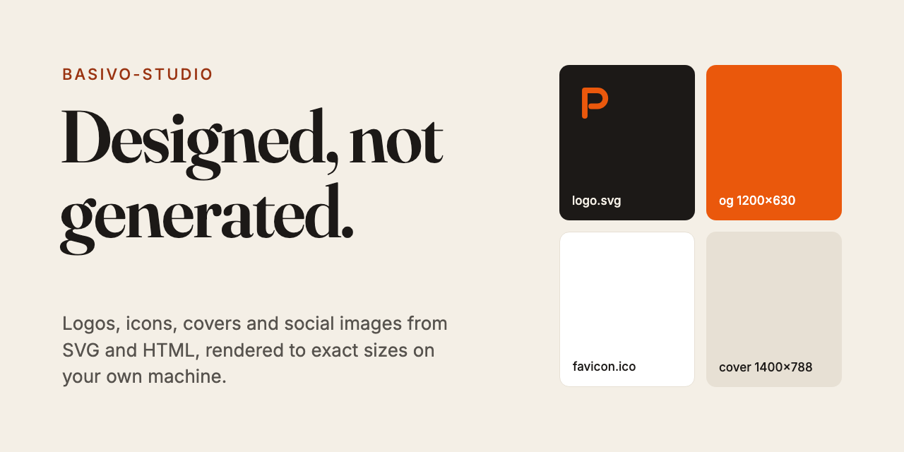

# basivo-studio



**Logos, icons and social images for Claude Code, designed rather than generated.**
Claude writes SVG and HTML, and the headless Chrome or Edge already on your machine
renders them into exact-size PNGs.

- **Text is always spelled right.** It's real type, not pixels an image model guessed.
- **Logos are real vectors**, so they're sharp at any size and you can edit them.
- **Exact sizes** for every platform, plus a full favicon and app-icon set from one SVG.
- **One brand kit** of colours, fonts and logo, so every image matches.
- **Free and offline.** Standard-library Python, with no API keys, no image model and no npm.

## Commands

| Command | What you get |
|---|---|
| `/studio-brand [name]` | `studio/brand.json` (colours, fonts, logo, style) and a swatch board |
| `/studio-logo <name> [idea]` | 4 distinct SVG concepts on one board; pick one and get the final set: mark, mono versions, lockup, PNGs |
| `/studio-image <type> "<headline>"` | A cover, Open Graph card, banner, thumbnail, quote card, carousel or diagram at the right size |
| `/studio-icons <logo.svg>` | favicon.ico and .svg, apple-touch-icon, PWA 192/512, maskable icon, site.webmanifest and the `<head>` tags |

You can also just ask: *"make a YouTube thumbnail for my video about MCP servers"*.

Claude looks at a small check copy of every image before handing it over. It fixes
clipping, contrast and cramped layouts, and follows design rules that avoid the usual
"AI look" (purple gradients, glowing blobs, everything centred).

## Sizes

`studio.py sizes` lists them all: `og` 1200×630, `medium-cover` 1400×788, `blog-cover`
1600×900, `youtube-thumb` 1280×720, `x-post`, `x-banner`, `linkedin-post`,
`linkedin-banner`, `instagram-post`, `instagram-portrait`, `story`, `youtube-banner`,
`slide`, `logo`, `github-social`. You can also give any `--size WxH`, and `--scale 2`
for retina.

## Install (any OS)

You need Claude Code, Python 3.8+ and Google Chrome, Microsoft Edge, Chromium or
Brave. Windows always has Edge.

```
claude plugin marketplace add mohamedabubasith/basivo-plugins
claude plugin install basivo-studio@basivo
```

Restart Claude Code. If your browser is somewhere unusual, set `BASIVO_STUDIO_BROWSER`
to its path. `studio.py doctor` shows which browser it will use.

## Where files go

Sources and images go in `studio/<name>/` in your project (`.html`/`.svg` next to the
`.png`), so you can ask for changes later. Icons go in `public/` when the project has
one.

## Limits

No photographs or realistic scenes: that needs an image model. Studio can place your
own photos and screenshots into layouts.

Works well with [basivo-operator](https://github.com/mohamedabubasith/basivo-operator):
make the cover here, then have the operator upload it to Medium.

## Tests

```
python3 tests/test_studio.py
```

Part of the [Basivo plugins](https://github.com/mohamedabubasith/basivo-plugins).
Made by [Basivo](https://basivo.in).
